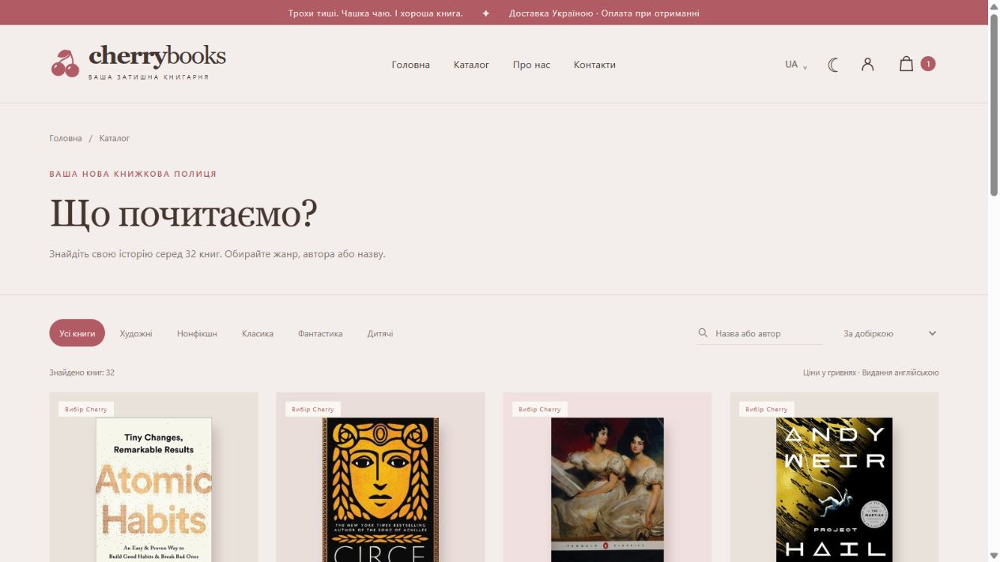
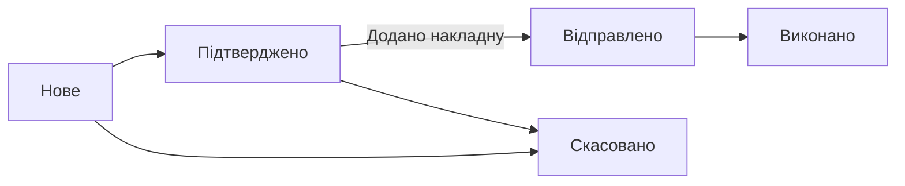
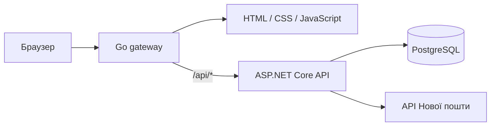

<div align="center">


# Cherry Books

### У кожної книги є своя людина.

Книгарня з теплим характером — від вибору наступної історії до оформлення доставки.

**Go · ASP.NET Core 10 · PostgreSQL 17**

[](https://github.com/danafffft/bookshop-unlab/actions/workflows/verify.yml)


[**Відкрити магазин ↗**](https://cherry-books.onrender.com/) · [Каталог](https://cherry-books.onrender.com/catalog/) · [Вхід адміністратора](https://cherry-books.onrender.com/admin/login/)



<sub>Кремові відтінки, вишневі акценти та гармонійна темна тема.</sub>

</div>

---

## Про проєкт

Cherry Books — багатосторінковий магазин із власним API та PostgreSQL. Покупці знаходять книги, оформлюють замовлення й стежать за статусами. Адміністратор керує каталогом, залишками та відправленнями через окрему панель.

Початкова добірка містить **32 реальні англомовні видання** з ISBN, описами та оригінальними обкладинками. Українські назви допомагають орієнтуватися в каталозі; мову видання зазначено на кожній картці.

## Можливості

| Для покупця | Для адміністратора |
| --- | --- |
| Пошук за назвою, автором та ISBN | Додавання й редагування книг |
| Жанри, сортування та пагінація | Ціни, залишки, видимість і добірки |
| Окрема сторінка кожної книги | Описи українською та англійською |
| Реєстрація через email і пароль | Окремий вхід із перевіркою ролі |
| Кошик та оформлення замовлення | Пошук замовлень і фільтр за статусом |
| Міста й пункти Нової пошти з API | Підтвердження та керування відправленнями |
| Власні замовлення й номер накладної | Додавання номера накладної |
| Скасування до відправлення | Скасування з поверненням книг на склад |

Інтерфейс перемикається між **українською та англійською**, підтримує дві теми й адаптується до мобільних екранів. Google OAuth не використовується.

## Доставка та замовлення

1. Покупець знаходить місто в актуальному довіднику Нової пошти.
2. Обирає відділення або поштомат: є пошук за номером чи вулицею, підвантаження наступних пунктів, адреса та графік роботи.
3. Сервер перевіряє відповідність міста й пункту отримання та нормалізує український номер телефону.
4. Після підтвердження адміністратор створює накладну в кабінеті перевізника й додає її номер до замовлення.
5. Покупець бачить номер у своєму кабінеті та посилання на офіційне відстеження.



Покупець може скасувати **лише власне** нове або підтверджене замовлення. Повернення залишків відбувається один раз у транзакції. Повторне скасування й скасування після відправлення заблоковані.

**Підсумок на сайті включає книги.** Доставка й комісія післяплати оплачуються окремо за тарифами перевізника. Накладні автоматично не створюються; для внесеного номера перевіряється формат із 14 цифр.

Докладніше: [інтеграція Нової пошти](NOVA-POSHTA.md).

## Архітектура



| Частина | Призначення |
| --- | --- |
| **Go** | Статичні сторінки, заголовки захисту та проксі API |
| **ASP.NET Core 10** | Авторизація, каталог, замовлення, адміністрування й доставка |
| **PostgreSQL 17 + libpq** | Зберігання даних і параметризовані SQL-запити |
| **Render + Neon** | Публічний Docker-сервіс і зовнішня база даних |

Ціни зберігаються цілими копійками; суму замовлення визначає сервер. Під час покупки рядки книг блокуються в стабільному порядку: останній примірник не можна продати двічі паралельними запитами.

## Швидкий запуск

Потрібен **Docker із Docker Compose**. Команди виконуйте в корені репозиторію.

```bash
git clone https://github.com/danafffft/bookshop-unlab.git
cd bookshop-unlab
```

1. Скопіюйте `.env.example` у `.env`.
2. Задайте `DB_PASSWORD`, власний `ADMIN_EMAIL` і випадковий `ADMIN_PASSWORD` довжиною щонайменше 12 символів.
3. Запустіть сервіси:

```bash
docker compose up --build -d
```

| Сторінка | Локальна адреса |
| --- | --- |
| Магазин | http://localhost:8080 |
| Вхід адміністратора | http://localhost:8080/admin/login/ |
| Перевірка API та бази | http://localhost:8080/api/health |

Зупинка: `docker compose down`. Дані залишаються в томі `postgres-data`; параметр `-v` видалить цей том разом із даними.

### Доступ адміністратора

API створює адміністратора під час запуску, якщо заданого `ADMIN_EMAIL` ще немає в базі. Для входу використовуйте `/admin/login/` і власні значення з `.env` або секретів Render.

Зміна `ADMIN_PASSWORD` у змінних середовища **не змінює пароль уже створеного акаунта**. Наявний покупець із таким самим email також не отримує роль адміністратора автоматично. Паролі та ключі не зберігаються в репозиторії.

<details>
<summary><strong>Запуск без Docker</strong></summary>

Потрібні Go 1.23+, .NET SDK 10, PostgreSQL 17 та `libpq`. У Linux бібліотеку надає пакет `libpq5`. У Windows додайте папку `bin` PostgreSQL до `PATH`; за потреби задайте її абсолютний шлях у `PG_LIB_DIR`.

Створіть базу `cherrybooks` і задайте середовище API:

```dotenv
DATABASE_URL=Host=localhost;Port=5432;Database=cherrybooks;Username=cherry;Password=YOUR_DATABASE_PASSWORD
ADMIN_EMAIL=admin@example.com
ADMIN_PASSWORD=YOUR_LONG_RANDOM_PASSWORD
PUBLIC_ORIGIN=http://localhost:8080
COOKIE_SECURE=false
```

З кореня репозиторію запустіть `dotnet run --project api/CherryBooks.csproj`. В іншому терміналі перейдіть у `gateway` і виконайте `go run .`.

Схема й початковий каталог застосовуються автоматично. Перезапуск не перезаписує зміни адміністратора та залишки книг.

</details>

## Розгортання

Публічний магазин: **[cherry-books.onrender.com](https://cherry-books.onrender.com/)**.

Конфігурація [render.yaml](render.yaml) збирає [Docker-образ](deploy/render/Dockerfile) із Go та ASP.NET Core. PostgreSQL розташована окремо в Neon. Перевірка працездатності — `/api/health`.

| Змінна API | Призначення |
| --- | --- |
| `DATABASE_URL` | Рядок підключення PostgreSQL |
| `ADMIN_EMAIL` | Email адміністратора для початкового створення |
| `ADMIN_PASSWORD` | Початковий пароль адміністратора, від 12 символів |
| `PUBLIC_ORIGIN` | Точна адреса сайту для перевірки Origin |
| `COOKIE_SECURE` | `true` для публічного HTTPS-сайту |
| `NOVA_POSHTA_API_KEY` | Необов’язковий ключ перевізника; перевірені довідникові методи працювали без нього |

У Render `PUBLIC_ORIGIN` береться з `RENDER_EXTERNAL_URL`, якщо його не задано окремо. Ключі й паролі вносяться в **Environment** сервісу.

Безкоштовний Render може зупиняти сервіс після бездіяльності: перший запит після паузи потребує часу на запуск.

## Захист даних

- Паролі: PBKDF2-SHA512, 210 000 ітерацій та унікальна випадкова сіль.
- Сесії: випадкові токени в `HttpOnly` / `SameSite=Strict` cookie; у базі — SHA-256 токена.
- Права адміністратора й доступ до власних замовлень перевіряються сервером.
- Запити зміни даних перевіряють `Origin`; вхід і пошук доставки мають обмеження частоти.
- SQL-запити параметризовані; ціни та доступні залишки перевіряються під час оформлення.
- У `localStorage` зберігаються кошик, мова й тема; паролів там немає.

## Перевірки

[GitHub Actions](https://github.com/danafffft/bookshop-unlab/actions/workflows/verify.yml) збирає Go й .NET та запускає інтеграційний сценарій на окремій тестовій PostgreSQL.

Перевіряються реєстрація, сесії, права доступу, приватність замовлень, серверні ціни, залишки, одноразове повернення книг при скасуванні, паралельна покупка останнього примірника, живі довідники Нової пошти, пагінація, телефон і накладні.

```bash
dotnet build api/CherryBooks.csproj -c Release
node --check web/app.js
cd gateway
go test ./...
```

Для `tests/integration.mjs` потрібні `TEST_ONLY=1` та окрема тестова база: сценарій створює користувачів і замовлення. Готове середовище описане в [workflow](.github/workflows/verify.yml).

## Структура

```text
├── api/                    # ASP.NET Core, авторизація, замовлення, доставка
├── gateway/                # Go: статичні файли й проксі API
├── web/                    # 14 сторінок, стилі, JavaScript, обкладинки
├── db/                     # Ідемпотентна схема та початкові книги
├── deploy/render/          # Docker-образ і запуск публічного сервісу
├── docs/images/            # Зображення для README
├── tests/                  # Інтеграційні перевірки
├── .github/workflows/      # CI
├── compose.yaml            # Локальне середовище
└── render.yaml             # Конфігурація Render
```

## Поточні межі

Ціни та залишки початкового каталогу — **демонстраційні**. Реальний склад і постачальники не підключені. Оформлення створює запис у PostgreSQL; оплата доступна при отриманні. Картковий еквайринг, автоматичне створення накладних, email-сповіщення, відновлення пароля та підтвердження email наразі не реалізовані.

Оригінальні обкладинки отримано з [Open Library](https://openlibrary.org/dev/docs/api/covers) і збережено в `web/covers/`, тому їх показ не залежить від зовнішніх запитів під час перегляду каталогу.

---

<div align="center">

**Cherry Books** · Трохи тиші. Чашка чаю. І хороша книга.

[Магазин](https://cherry-books.onrender.com/) · [Каталог](https://cherry-books.onrender.com/catalog/) · [Контакти](https://cherry-books.onrender.com/contacts/)

</div>
